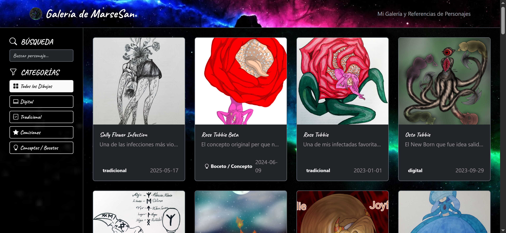
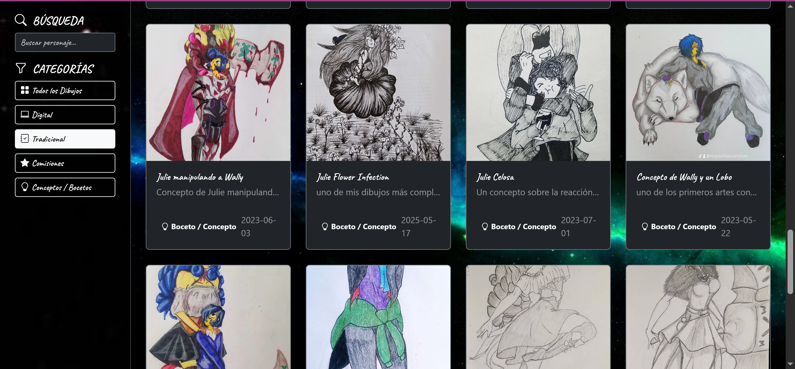
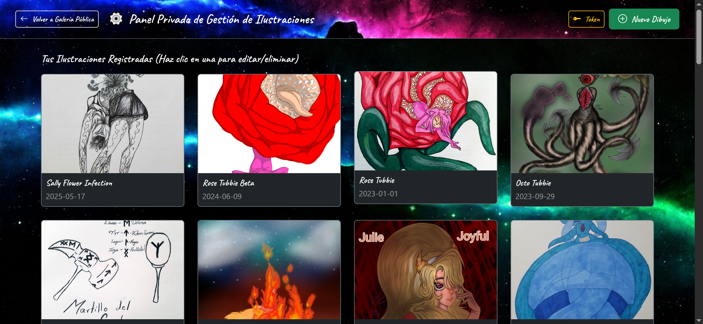
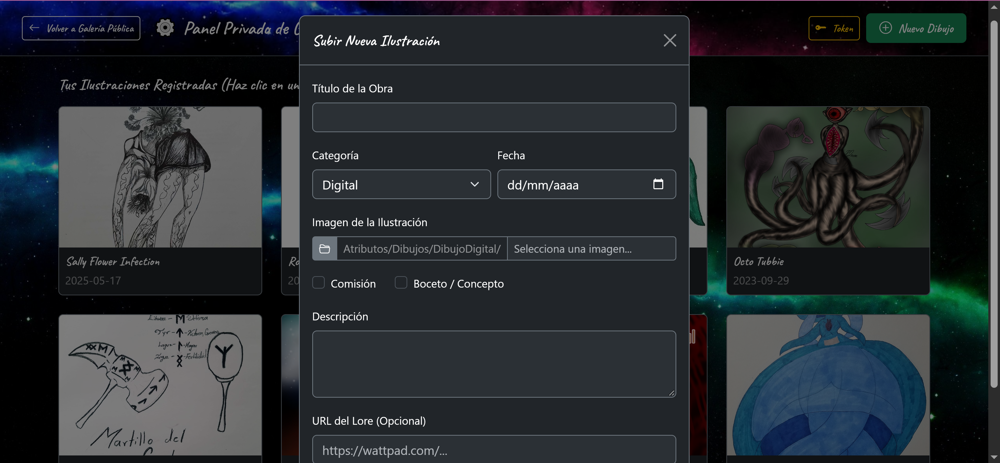
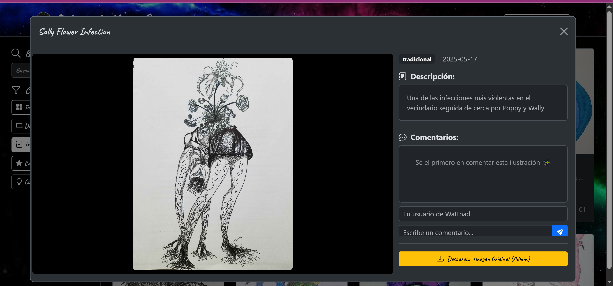

# Galería de MarseSan

Galería personal para guardar, organizar y consultar mis dibujos (digitales y tradicionales) desde cualquier dispositivo, sin depender de una red social. Incluye búsqueda, categorías, un modo administrador para subir y descargar obras, y comentarios de visitantes sin necesidad de registro.

🔗 [Ver proyecto en vivo](https://danisasantillan.github.io/galeria-de-marsesan/)
📂 [Ver código fuente](https://github.com/DanIsaSantillan/galeria-de-marsesan)

## Capturas

## Por qué existe este proyecto

Los dibujos digitales se pierden al cambiar de dispositivo o borrar la app de dibujo, y los dibujos físicos se pierden junto con el cuaderno o la hoja. Quería un lugar propio, organizado y accesible desde cualquier dispositivo con solo tener el link, sin mezclar las imágenes con las fotos del celular y sin depender de una cuenta en una red social.

## Funcionalidades

- **Categorías:** Digital y Tradicional, más subcategorías transversales: Bocetos/Conceptos y Comisiones (dibujos encargados por otras personas).
- **Búsqueda** por personaje y filtro por categoría. En escritorio, los filtros viven en una barra lateral; en celular pasan a un menú superior.
- **Modal de detalle:** al hacer clic en un dibujo se ve completo, con su descripción, la fecha y un enlace opcional a la historia relacionada.
- **Comentarios de visitantes** sin necesidad de crear cuenta, pensados para quien reciba el link y quiera dejar su opinión.
- **Modo administrador** (acceso oculto): permite descargar los dibujos, que para el público están protegidos contra descarga directa.
- **Panel de gestión:** una segunda página, accesible solo desde el modo administrador, donde se pueden subir, editar o eliminar dibujos. Cada subida se publica directamente en el repositorio de GitHub.
- **Instalable como app** en el celular, con ícono propio.

## Stack técnico

- HTML, Bootstrap, CSS y JavaScript
- **GitHub** como almacenamiento de imágenes (carpetas por categoría) y **GitHub API** para publicar desde el panel de administrador
- **`dibujos.json`** como base de datos de los metadatos de cada dibujo
- **Firebase** para los comentarios de visitantes
- **`manifest.json`** para poder instalar la página como app en el celular

JavaScript lee `dibujos.json`, genera automáticamente las tarjetas al cargar la página, y las ordena o filtra según la categoría elegida.

## Decisiones técnicas

**GitHub como almacenamiento de imágenes:** las carpetas de dibujos ya existían durante el desarrollo, así que en vez de montar un servicio externo hice que el panel de administrador guardara las imágenes directamente en el repositorio, por categoría. Es una solución simple y sin costo para un proyecto personal. Si el volumen de imágenes crece demasiado, planeo migrar a un servicio de almacenamiento pensado para imágenes.

**`dibujos.json` como base de datos de metadatos:** guarda título, fecha, categoría, descripción y ruta de cada imagen. Las tarjetas se generan a partir de este archivo, así que agregar un dibujo nuevo no requiere tocar el HTML.

**Acceso oculto al modo administrador:** se activa con un triple clic sobre la imagen de perfil. Un contador cuenta los clics dentro de una ventana de pocos segundos; si pasa demasiado tiempo entre clics, el contador se reinicia y no pasa nada. Así el botón de administrador no ensucia la interfaz pública.

**Token de GitHub para guardar cambios:** para subir, editar o eliminar dibujos, el panel exige un token de acceso de GitHub creado específicamente para este proyecto. Sin un token válido, nada se guarda, aunque alguien llegara al panel de administrador.

**Panel de administrador como página aparte:** su HTML y JavaScript viven en su propia carpeta, separados de la galería pública, para mantener cada parte ordenada.

**Protección contra descargas:** la galería pública bloquea las descargas directas (por ejemplo, guardar imagen con clic derecho), y solo el modo administrador permite descargar.

## Retos que resolví

- **Guardar imágenes en GitHub desde el navegador:** hacer que el JavaScript del panel de administrador publicara los dibujos directamente en el repositorio fue lo más difícil del proyecto, porque implicaba usar la API de GitHub con autenticación por token por primera vez.
- **Token por navegador:** el token se guarda en el navegador donde se valida, así que en otro navegador o dispositivo hay que volver a ingresarlo, y además caduca con el tiempo. Hay que guardarlo de forma segura o generar uno nuevo cuando haga falta.
- **Diseño visual:** quería evitar un fondo plano. Acomodé una imagen de fondo para la página y fondos propios para la barra superior y la barra lateral, de forma que se vieran bien juntos tanto en escritorio como en celular.
- **Convertirla en app instalable:** el código que me dio una IA no funcionó al primer intento. Tuve que ajustar el archivo `manifest.json` por prueba y error hasta que apareció el ícono con mi imagen de perfil en el celular.

## Limitaciones conocidas

- La protección de descargas desalienta el guardado casual, pero no es seguridad real: las imágenes viven en un repositorio público de GitHub, y las capturas de pantalla no se pueden bloquear.
- El panel de administrador está pensado para una sola persona, sin cuentas de usuario.
- El almacenamiento en GitHub tiene límites de tamaño, así que no escala a miles de imágenes.
